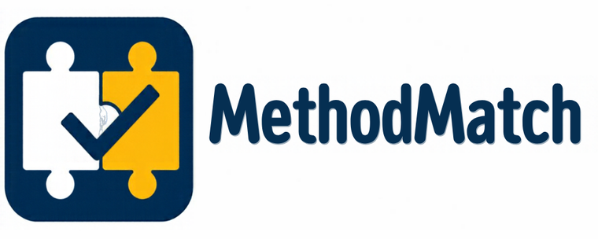

<p align="center">
  
</p>

# MethodMatch

Check that a study hangs together: every objective has a question, every question has variables, a method, an analysis and findings, and nothing is left dangling.

Theses and proposals often fail at the joins: an objective no question answers, a finding that does not trace back to an analysis, a variable that is measured but never analysed. MethodMatch checks the links you declare, in both directions. It uses only the Python standard library and makes no network requests.

## Install

Requires Python 3.10 or newer.

```bash
pip install git+https://github.com/seun-john/methodmatch.git
```

## Use

```bash
methodmatch check study.json -o report.json --html report.html --strict
```

`study.json` has six lists. Every record has a unique string `id`.

| List | Fields |
| --- | --- |
| `objectives` | `text`, `question_ids` |
| `questions` | `text`, `variable_ids`, `method_id`, `analysis_id`, `finding_ids` |
| `variables` | `name` |
| `methods` | `name`, `variable_ids` |
| `analyses` | `name`, `variable_ids`, `method_ids` |
| `findings` | `text`, `question_ids`, `analysis_id` |

Per question you get `LINKS_COMPLETE` or `BROKEN_ALIGNMENT` with the objective, variables, method, analysis and findings that were found, and lists of what is `missing` and what is inconsistent:

- the question has no objective, variables, method, analysis or findings;
- the method or analysis does not declare all of the question's variables;
- the analysis is not linked to the question's method;
- a finding does not link back to the question and the analysis;
- an id points at something that does not exist.

Across the whole study you also get `UNKNOWN_QUESTION`, `UNKNOWN_VARIABLE`, `UNKNOWN_METHOD`, and `ORPHAN_OBJECTIVE`, `ORPHAN_VARIABLE`, `ORPHAN_METHOD`, `ORPHAN_ANALYSIS`, `ORPHAN_FINDING` for things nothing links to.

All commands take `-o report.json`, `--html report.html` and `--strict`. Exit codes: 0 completed, 1 `--strict` and any finding other than `LINKS_COMPLETE`, 2 unusable input.

## Limits

`LINKS_COMPLETE` means the structure is complete. It says nothing about whether the sample, measures, design, causal claims or statistical assumptions are appropriate. A research reviewer has to judge those. The links are only as good as what you declared.

## Develop

```bash
pip install -e ".[dev]"
ruff check . && ruff format --check . && pytest -q
```

MIT licence.


## Research paper

This tool was evaluated, with and without each tool, in an open preprint: Oluwawalemi, O. J. (2026). Do Verification Tools Improve on an AI Reader? A With-and-Without Evaluation of Fifteen Open-Source Tools for AI-Assisted Research. Zenodo. https://doi.org/10.5281/zenodo.23404947

The test corpora, truth labels, verdicts and scripts are in the same Zenodo record. Independent replication and testing are welcome. Please open an issue to share results.
